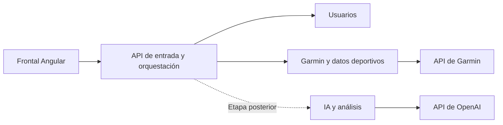

# Arquitectura del backend con microservicios

## 1. Objetivo y estado

Además de resolver las necesidades de la aplicación, el proyecto servirá para aprender arquitectura de microservicios. Se ha confirmado comenzar con tres servicios ejecutables y desplegables de forma independiente: API/orquestación, usuarios y Garmin/datos deportivos. IA se incorporará después. Primero se utilizarán en el equipo del usuario; el alojamiento se decidirá después.

La descripción funcional del backend en [ECOSISTEMA.md](ECOSISTEMA.md) no implica un único proceso. Se mantendrá una API propia para el frontal y se concretará el reparto de responsabilidades entre servicios.

## 2. Distribución acordada y responsabilidades propuestas

| Servicio | Responsabilidad | Límites propuestos |
| --- | --- | --- |
| API de entrada y orquestación | Atender al frontal, validar la sesión y coordinar operaciones que necesitan varias áreas. | Cada servicio comprobará también los permisos que le correspondan. La orquestación no concentrará todas las reglas ni accederá directamente a todas las tablas. |
| Gestión de usuarios | Cuentas, perfil, permisos y asociación con la identidad autenticada. | El mecanismo de autenticación está pendiente. No custodiará por defecto todas las credenciales de plataformas externas. |
| Garmin y datos deportivos | Vinculación con Garmin, importaciones y consulta de entrenamientos, VFC y sueño por usuario. | La traducción de datos de Garmin se separará internamente de las consultas deportivas. Este límite permite evaluar después si necesitan servicios distintos. |
| IA y análisis | Conexión propia a OpenAI, prompts, preparación del contexto y análisis; memoria y resultados según la política que se acuerde. | Usará datos deportivos autorizados recibidos mediante contratos; no leerá directamente las tablas del área deportiva. Seguirá siendo opcional. |

Los tres primeros servicios pertenecen a la primera entrega. El de IA corresponde a una etapa posterior. La distribución está confirmada; los contratos y el detalle de responsabilidades y persistencia requieren diseño.

### Orquestador y entrada de API

El término orquestador se utilizará para la coordinación de un caso de uso, por ejemplo reunir métricas y solicitar un análisis. La entrada de API recibe y dirige peticiones del frontal. Ambas funciones podrían convivir inicialmente, pero son responsabilidades distintas. No se está proponiendo un orquestador de infraestructura o contenedores.

### Repositorios y acceso a datos

La propuesta inicial es que cada área tenga sus repositorios internos para los datos que posee. Un repositorio encapsula las operaciones de persistencia; no necesita ser por sí mismo un servicio accesible por red.

Un gestor de repositorio genérico al que llamasen todos los servicios concentraría el acceso a sus datos y podría obligarlos a coordinar cambios de esquema y disponibilidad. Si se crea un servicio de datos compartido, conviene que tenga una responsabilidad funcional concreta, como la consulta del histórico deportivo, y un contrato propio.

Esta propuesta de repositorios internos está pendiente de aprobación. El requisito confirmado de una base de datos escalable no obliga a un servicio central de persistencia ni a una instancia física de base de datos por servicio.

## 3. Distribución inicial y evolución

El diagrama completo, incluidos frontal, persistencia, conexiones externas y posibles extensiones, está en [ECOSISTEMA.md](ECOSISTEMA.md). Este esquema se centra en el backend.

API/orquestación, usuarios y Garmin/datos deportivos son unidades independientes desde el inicio; IA se incorpora después. Los contratos de las llamadas están pendientes. Se propone que cada servicio acceda a sus propios datos mediante repositorios internos. Las conexiones con Garmin y OpenAI seguirán vinculadas al usuario según [CONEXIONES_Y_CONSUMO.md](CONEXIONES_Y_CONSUMO.md).

## 4. Ejemplos de coordinación

**Consultar entrenamientos:** el frontal pide un día o un rango; la entrada de API valida la sesión y solicita los datos al área deportiva con la identidad del usuario. Esta comprueba la autorización y resuelve la consulta según la estrategia de almacenamiento y actualización. No interviene IA.

**Solicitar un análisis:** la entrada de API coordina la recuperación de los datos deportivos autorizados y la petición al área de IA. Esta selecciona el contexto junto con la memoria propia que proceda, utiliza la conexión OpenAI del solicitante y devuelve el resultado. No es necesario sincronizar de nuevo todo Garmin para cada análisis.

**Actualizar el histórico:** el área deportiva gestiona la importación. Si el volumen o los tiempos lo requieren, se evaluará trabajo en segundo plano y consulta de su estado. La cola y el mecanismo de programación no están elegidos.

## 5. Alternativas consideradas y dirección acordada

| Alternativa | Qué permite practicar | Coste que hay que asumir |
| --- | --- | --- |
| Un backend con módulos separados | Límites funcionales, contratos internos y propiedad de datos; permite extraer servicios después. | No practica por sí solo despliegues independientes ni fallos de red entre servicios. |
| Pocos servicios desde el inicio | Contratos remotos, despliegue independiente, diagnóstico y tratamiento de fallos parciales. | Más procesos, configuración, llamadas de red y pruebas de integración desde la primera entrega. |

Se ha elegido la dirección de servicios independientes desde el inicio y se ha confirmado separar usuarios como servicio propio. API/orquestación, usuarios y Garmin/datos deportivos se ejecutarán en el mismo equipo; eso no impide mantener sus contratos y arranque independientes. IA llegará después.

El aprendizaje tiene valor propio en esta elección, aunque el grupo inicial sea reducido. Debe acordarse cuánto tiempo y coste operativo se quiere dedicar a él.

## 6. Aspectos que deben resolverse si se separan servicios

- **Contratos:** operaciones, formatos, errores, paginación y compatibilidad entre versiones.
- **Identidad:** cómo se autentican los servicios entre sí y cómo se transmite y verifica el usuario autorizado; no confiar en un identificador libre enviado por el navegador.
- **Datos:** propietario de cada conjunto de datos y migraciones. Una instancia compartida inicialmente puede evaluarse con esquemas y permisos separados; cada servicio evitará leer o escribir tablas ajenas.
- **Consistencia:** qué operaciones admiten actualización diferida y cómo se recupera una operación completada solo en parte.
- **Fallos:** tiempos de espera, disponibilidad parcial y reintentos. Repetir una importación no debe duplicar datos; repetir una solicitud de IA puede generar consumo adicional y necesita una política propia.
- **Diagnóstico:** identificador de petición compartido y registros correlacionados sin secretos ni datos personales innecesarios.
- **Desarrollo y despliegue:** cómo levantar el conjunto localmente, configurar secretos, comprobar el estado y desplegar un servicio sin romper a sus consumidores.

No se eligen todavía lenguaje, framework, motor de datos, transporte, cola, contenedores ni plataforma de alojamiento. Microservicios tampoco determina que haya varios repositorios de código.

El usuario tiene experiencia en el ecosistema .NET. Por ese motivo se propone .NET con ASP.NET Core como base del backend, pendiente de confirmar framework, versión y librerías. ASP.NET Core documenta soporte para APIs, inyección de dependencias, configuración, autenticación y diagnóstico. Esto aporta una base técnica a la propuesta, no sustituye el diseño de los servicios. [Documentación oficial de Microsoft, consultada el 30 de octubre de 2026](https://learn.microsoft.com/en-us/aspnet/core/overview?view=aspnetcore-10.0).

## 7. Validación y decisiones siguientes

1. Con tres servicios iniciales acordados, concretar el recorrido formativo y la base tecnológica.
2. Diseñar contratos y propiedad de datos, manteniendo usuarios como servicio independiente.
3. Contrastar la separación con el acceso real a Garmin, la autenticación y el presupuesto.
4. Diseñar un recorrido mínimo entre servicios con datos de prueba: consulta por rango, autorización y fallo del servicio deportivo.
5. Verificar despliegue independiente, trazabilidad y ausencia de duplicados antes de ampliar la separación.

La prueba de arquitectura puede utilizar datos simulados mientras se valida Garmin. Sus resultados no demostrarán por sí solos que la integración real sea viable. La distribución final se registrará en [DECISIONES.md](DECISIONES.md).
