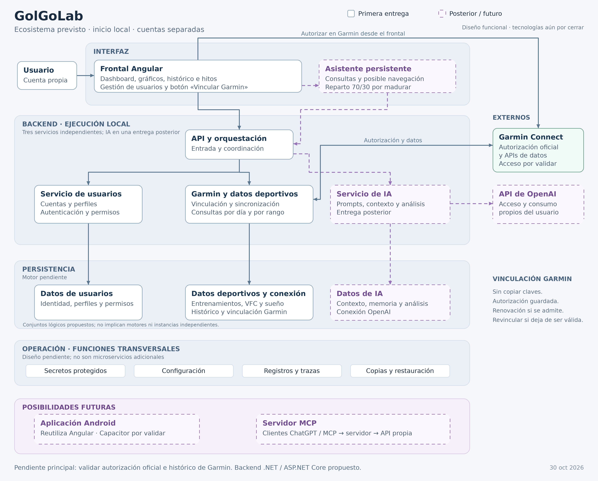
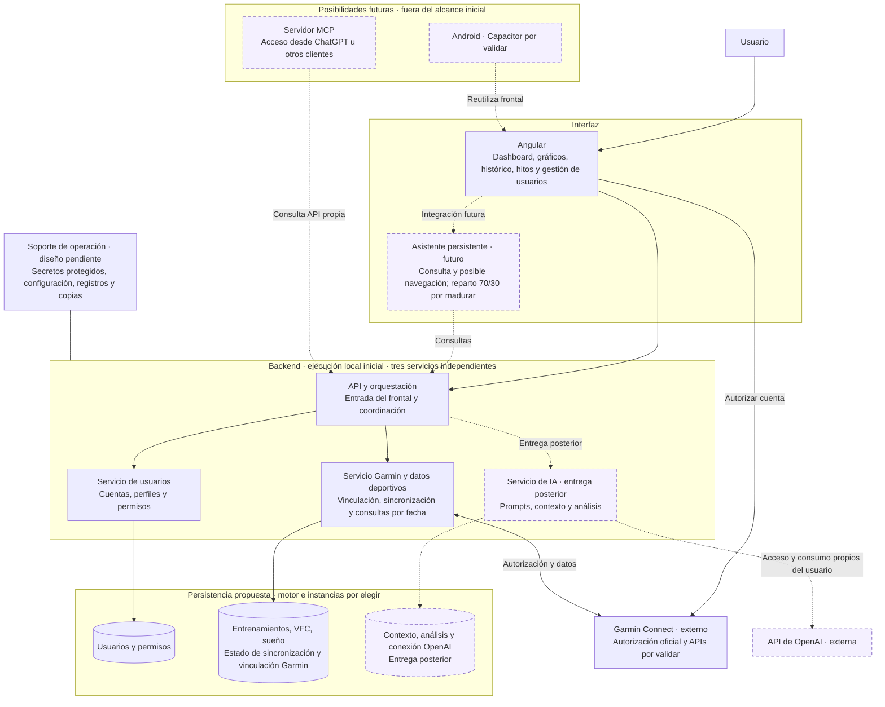

# Componentes del ecosistema

Este documento describe las partes del ecosistema, su función y sus relaciones. Se completará componente a componente. Por ahora se han definido la aplicación frontal, el backend y la persistencia; el catálogo completo sigue abierto.

Para cada componente se recogerán su propósito, responsabilidades, alcance inicial, evolución prevista, dependencias y cuestiones pendientes. La visión general se mantiene en [PROYECTO.md](PROYECTO.md) y los requisitos verificables en [ALCANCE_Y_REQUISITOS.md](ALCANCE_Y_REQUISITOS.md).

## Diagrama general

El diagrama representa el ecosistema previsto, no una implementación existente. Las líneas continuas corresponden al alcance inicial o a sus funciones de soporte; las discontinuas y los bloques de borde discontinuo corresponden a etapas posteriores. La vinculación con Garmin es un requisito cuyo acceso oficial todavía debe validarse.

[PNG en alta resolución](diagramas/ecosistema.png) · [SVG vectorial](diagramas/ecosistema.svg).

Ver esquema en Mermaid

[Fuente Mermaid](diagramas/ecosistema.mmd) · [Generador de las imágenes](diagramas/render_ecosistema.py).

Los bloques de persistencia representan conjuntos lógicos de información, no tres motores ni tres instancias obligatorias. Los repositorios se proponen como capas internas de cada servicio. La custodia de secretos, los registros y las copias son funciones de operación, no microservicios adicionales aprobados. Las flechas muestran relaciones funcionales; protocolos, endpoints y contratos siguen pendientes.

La primera entrega tendrá frontal Angular, tres servicios independientes y persistencia, con ejecución local. .NET con ASP.NET Core es la propuesta de backend basada en la experiencia del usuario. IA será posterior; el asistente persistente, Android y MCP son evoluciones distintas.

## 1. Aplicación frontal Angular

### Propósito y estado

Interfaz desde la que cada usuario consulta sus datos deportivos y su evolución. Angular queda elegido como tecnología del frontal. Su versión, las bibliotecas de interfaz y gráficos y la organización interna están pendientes.

### Primera versión

El planteamiento funcional confirmado incluye:

- Un dashboard propio para cada usuario, con información deportiva relevante.
- Gráficos de seguimiento y evolución.
- Consulta del histórico de actividades.
- Visualización de hitos.
- Gestión de usuarios, dentro del uso inicial por un grupo reducido con cuentas separadas.

Los datos deportivos procederán de Garmin. El acceso a su API y los campos disponibles requieren validación. Los indicadores, gráficos, filtros y la definición de los hitos se concretarán después; esta descripción no presupone que Garmin proporcione directamente todos esos elementos.

La gestión de usuarios está incluida como capacidad, pero todavía hay que definir las operaciones disponibles, quién podrá realizarlas y si existirán roles administrativos. Un dashboard por usuario no implica que otros usuarios puedan consultarlo.

Desde el frontal se gestionará la vinculación propia de Garmin mediante botón de autorización oficial, sin generar ni copiar claves. La conexión persistirá para consultas posteriores mientras sea válida, con revinculación cuando sea necesaria. Cuando se active IA, se configurará también el acceso propio a OpenAI, cuyo mecanismo se evaluará por separado. El modelo está en [CONEXIONES_Y_CONSUMO.md](CONEXIONES_Y_CONSUMO.md).

### Relación con el resto del ecosistema

De acuerdo con la decisión de contar con una API propia, el frontal consultará esa API para obtener los datos de la aplicación. La comunicación con Garmin y la comprobación de permisos corresponderán al backend descrito en la sección 2.

La interfaz deberá presentar el estado de los datos: carga, ausencia de actividades, última actualización y errores. Los requisitos concretos de importación y consulta se mantienen en el documento de alcance.

### Evolución futura: aplicación y asistente

Se plantea una vista con dos zonas simultáneas:

| Zona | Uso previsto | Reparto orientativo en escritorio |
| --- | --- | --- |
| Aplicación | Dashboard, gráficos, histórico, hitos y futuras secciones. | 70 % del ancho. |
| Asistente | Conversación y consulta de información mientras se utiliza la aplicación. | 30 % del ancho. |

El asistente permanecería presente durante la navegación. Se contempla que, además de responder consultas, pueda realizar navegación dentro de la aplicación. El alcance de esa interacción está por definir; no se consideran aprobadas acciones de modificación de datos.

Esta distribución es una idea por madurar, no una especificación cerrada de diseño ni una condición para la primera versión. La consulta deportiva seguirá siendo utilizable sin activar IA. Queda por decidir cómo se muestra, oculta o desactiva el asistente y cómo se aprovecha el espacio cuando no está activo.

### Cuestiones pendientes

- Contenido inicial del dashboard: indicadores, gráficos, periodos y filtros.
- Significado de hito: qué representa, de dónde procede y cómo se obtiene.
- Operaciones de gestión de usuarios, alta de cuentas y permisos.
- Navegación y secciones de la aplicación.
- Distribución en móvil y pantallas pequeñas; el reparto 70/30 solo es una referencia para escritorio.
- Contexto que recibirá el asistente sobre el usuario, la pantalla y la selección actual.
- Destinos de navegación que podrá abrir el asistente y cómo se reflejarán sus acciones en la interfaz.
- Persistencia de la conversación al cambiar de sección y comportamiento cuando el asistente no esté disponible.

Las cuestiones del asistente se resolverán al definir esa etapa. Por ahora se conserva la visión para tenerla en cuenta durante el diseño del frontal.

## 2. Aplicación backend

### Propósito y estado

Proporcionar la API propia de la aplicación, gestionar usuarios y centralizar las integraciones con Garmin y OpenAI. Desde la primera versión deberá estar preparado para obtener entrenamientos y métricas como VFC (variabilidad de la frecuencia cardiaca) y sueño.

Este alcance funcional está confirmado. El lenguaje, el framework y la forma de integración siguen abiertos. La disponibilidad efectiva de cada dato dependerá de la vía de acceso a Garmin que se valide.

El backend se distribuirá inicialmente en tres servicios independientes: API/orquestación, usuarios y Garmin/datos deportivos, también con un objetivo formativo. Se ejecutarán primero en el equipo del usuario. IA se incorporará después como servicio adicional. La distribución y los contratos pendientes se describen en [ARQUITECTURA_BACKEND.md](ARQUITECTURA_BACKEND.md).

### Primera versión

| Capacidad | Necesidad funcional |
| --- | --- |
| Gestión de usuarios | Gestionar las cuentas y comprobar el acceso a sus datos. Operaciones, roles y mecanismo de autenticación pendientes. |
| Entrenamientos de un día | Obtener los entrenamientos del usuario correspondientes a una fecha concreta. |
| Entrenamientos de un periodo | Obtener los entrenamientos del usuario comprendidos entre una fecha inicial y una final. |
| VFC | Obtener los datos de VFC disponibles para el usuario. Campos, resolución temporal e histórico pendientes. |
| Sueño | Obtener los datos de sueño disponibles para el usuario. Campos, sesiones e histórico pendientes. |
| Otras métricas | Permitir incorporar las métricas adicionales que se acuerden; su catálogo no está cerrado. |

Las consultas deberán estar asociadas al usuario autorizado. Los datos de VFC y sueño se tratarán como información propia, sin exigir que estén vinculados a un entrenamiento. No se presupone que Garmin utilice la misma interfaz o los mismos permisos para todas estas consultas.

### Integración con OpenAI y análisis con contexto

También es responsabilidad confirmada del backend conectarse a la API de OpenAI para enviar prompts con contexto y devolver los análisis solicitados por el usuario. La funcionalidad será opcional y se incorporará después de la primera entrega de datos y dashboard, según D-017 de [DECISIONES.md](DECISIONES.md).

Flujo funcional propuesto:

1. Recibir la petición de análisis del usuario autenticado.
2. Recuperar los datos y el contexto pertinentes de ese usuario: entrenamientos, métricas, objetivos o antecedentes que se hayan acordado.
3. Preparar el prompt y seleccionar únicamente el contexto necesario.
4. Enviar la solicitud a OpenAI desde el backend y devolver el resultado al frontal.
5. Guardar el análisis y la información de contexto que se decida conservar, vinculados a su propietario.

La memoria contextual seguirá siendo responsabilidad de la aplicación. Quedan pendientes los tipos de análisis, las plantillas de prompts, la selección y resumen del contexto, el modelo, los límites de uso y la política de conservación. Una petición de análisis no implica que exista ya el asistente persistente ni que pueda realizar navegación.

Las credenciales de OpenAI se gestionarán en el backend. El diseño deberá impedir que una petición incorpore datos de otro usuario y permitir seguir consultando la aplicación cuando el análisis falle o no esté activado. La comprobación de los detalles de la API se realizará al diseñar esta integración.

Inicialmente cada usuario aportará el acceso a OpenAI y asumirá su consumo. El backend usará la conexión correspondiente a ese usuario; la posibilidad futura de que el proveedor pague el acceso se evaluará por separado. El mecanismo de vinculación sigue pendiente y no se presupone idéntico al de Garmin.

### Relación con el resto del ecosistema

El frontal solicitará los datos al backend. Este resolverá su obtención desde Garmin o desde el almacenamiento de la aplicación según la estrategia de sincronización que se defina. Una consulta del frontal no implica necesariamente una llamada en tiempo real a Garmin.

El backend será responsable de comprobar el acceso a los datos de cada usuario y de gestionar de forma protegida la conexión con Garmin. El contrato de la API propia se definirá a partir de estas necesidades, sin fijar todavía rutas ni reproducir necesariamente la estructura de la API de Garmin.

El backend accederá a la base de datos para gestionar usuarios y los datos persistidos. También preparará las peticiones a OpenAI; el frontal utilizará la API propia para solicitar los análisis.

### Cuestiones pendientes

- Vía de acceso a Garmin y cobertura de entrenamientos, VFC y sueño por separado.
- Campos y nivel de detalle de cada consulta, unidades y profundidad del histórico.
- Zona horaria y límites incluidos en las consultas por fecha o rango.
- Fecha de referencia para el sueño, especialmente cuando una sesión atraviesa la medianoche.
- Distinción entre ausencia de registros, datos no disponibles, acceso no autorizado e importación incompleta.
- Estrategia de sincronización, almacenamiento, actualización y tratamiento de errores y límites de consulta.
- Catálogo de otras métricas y prioridades de incorporación.
- Operaciones de gestión de usuarios, autenticación y posibles roles.
- Tipos de análisis con IA, contexto necesario, conservación de resultados, límites de uso y costes.

La validación de acceso se detalla en [VALIDACION_TECNICA.md](VALIDACION_TECNICA.md). La tecnología del backend se elegirá cuando se conozcan esas restricciones.

## 3. Persistencia y base de datos

### Propósito y estado

Mantener los datos de la aplicación y dar soporte a la gestión de usuarios, la consulta deportiva y los análisis con contexto. Se confirma la necesidad de un motor de base de datos que permita crecer; el motor y el alojamiento están por elegir.

### Información prevista

| Información | Finalidad y estado |
| --- | --- |
| Usuarios y datos de acceso | Dar soporte a las cuentas y permisos. El esquema depende del mecanismo de autenticación elegido. |
| Conexiones con Garmin | Asociar la autorización al usuario y conservar estado y credenciales protegidas para consultas posteriores. Renovación y esquema pendientes de la vía oficial validada. |
| Conexiones con OpenAI | Asociar el acceso propio con su usuario y su estado. Secretos protegidos en servidor; mecanismo y almacenamiento por definir para la etapa de IA. |
| Entrenamientos, VFC y sueño | Consultar el histórico y la evolución. Qué se persiste y qué se recupera bajo demanda sigue pendiente. |
| Estado de importaciones | Conocer actualizaciones, errores y cobertura del histórico. Detalle propuesto por definir. |
| Contexto y análisis de IA | Conservar la información seleccionada para dar continuidad a los análisis. Contenido y retención pendientes para la etapa de IA. |

### Escalabilidad por concretar

La elección deberá evaluar el crecimiento de usuarios, años de histórico, detalle de las métricas, consultas simultáneas e historial de análisis. Hay que acordar volúmenes y objetivos medibles antes de afirmar que una opción cubre las necesidades.

Se ha confirmado como objetivo consultar todo el histórico disponible. La cobertura recuperable de entrenamientos, VFC y sueño puede ser distinta y todavía debe validarse; ese objetivo no garantiza acceso retroactivo ilimitado desde Garmin.

Criterios propuestos: integridad y separación de datos por usuario, consultas por fecha y periodo, índices, migraciones, copias y restauración, posibilidades de ampliar capacidad y coste de operación. El objetivo inicial sigue siendo un grupo reducido; el diseño debe permitir evolucionar desde ese punto de partida.

No se presupone que toda la información requiera motores distintos ni que la memoria de IA necesite una base vectorial. Estas opciones solo se evaluarán si los requisitos de consulta lo justifican.

### Relación con el resto del ecosistema

El backend será el punto de acceso a la persistencia para las operaciones de la aplicación. El frontal solicitará datos y análisis a través de la API propia.

Con la arquitectura de servicios acordada, falta definir qué datos posee cada uno y cómo accede a ellos. Un motor de base de datos no implica un gestor genérico de repositorio compartido por todos; esa alternativa se evalúa en el documento de arquitectura.

### Cuestiones pendientes

- Motor de base de datos y modalidad de alojamiento.
- Estimaciones de crecimiento, concurrencia y tiempos de respuesta esperados.
- Modelo de usuarios y relación de cada registro con su propietario.
- Granularidad, volumen y retención de los datos deportivos y del contexto de IA.
- Política de borrado, copias de seguridad y restauración.
