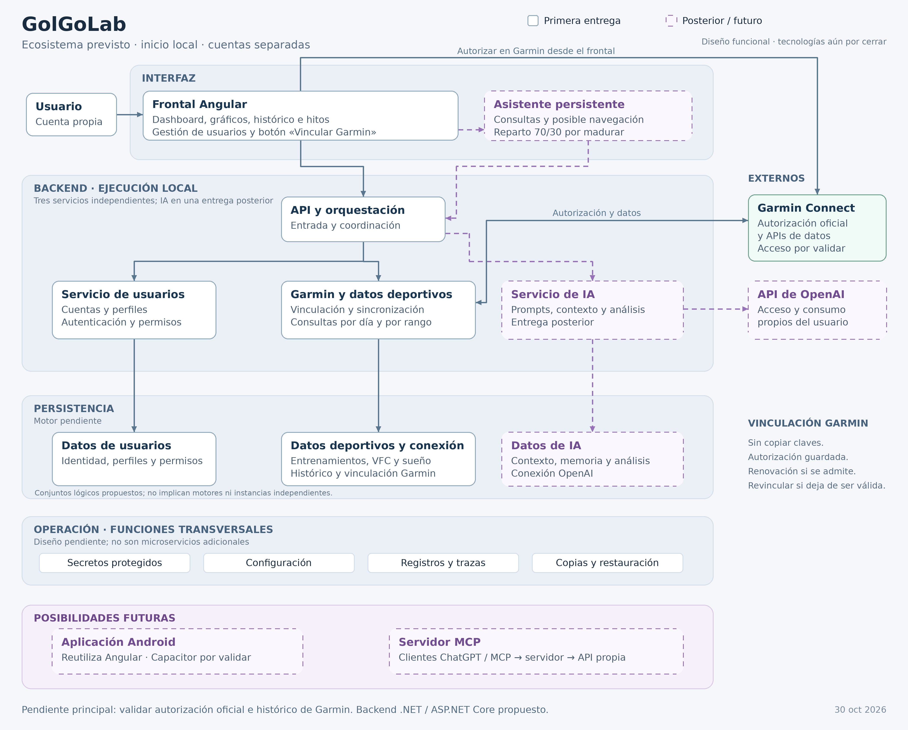

# GolGoLab

Aplicación para consultar entrenamientos y evolución deportiva a partir de datos de Garmin, inicialmente centrada en running. Permitirá visualizar el histórico, métricas e hitos de cada usuario y, en una etapa posterior, solicitar análisis con contexto mediante OpenAI.

El proyecto combina una herramienta de seguimiento deportivo con el aprendizaje práctico de una arquitectura de microservicios.

> **Estado:** definición funcional y técnica, previa a la implementación de la aplicación. El repositorio contiene la documentación y los diagramas del ecosistema previsto.

## Objetivos

- Consultar actividades y evolución deportiva desde una interfaz propia.
- Ofrecer cuentas separadas para un grupo reducido de usuarios, comenzando con ejecución local.
- Incorporar entrenamientos y métricas como VFC —variabilidad de la frecuencia cardiaca— y sueño, según el acceso disponible en Garmin.
- Mantener la consulta deportiva independiente de las funcionalidades de IA.
- Aprender a diseñar, comunicar y desplegar servicios independientes.

## Primera entrega

La primera versión se centrará en **dashboard y datos deportivos**:

- Frontal Angular con información por usuario, gráficos, histórico e hitos.
- Gestión de usuarios y permisos desde un servicio propio.
- Consulta de entrenamientos por día y por rango de fechas.
- Obtención de datos de VFC y sueño desde el backend.
- Vinculación de Garmin mediante un botón de autorización oficial, sin copiar claves, conservando la conexión mientras sea válida.
- Persistencia para usuarios, datos deportivos y estado de las conexiones.

El objetivo es consultar **todo el histórico disponible**. La autorización, la cobertura de datos y la profundidad del histórico requieren validar la vía oficial de Garmin aplicable al proyecto. Los indicadores, hitos y mecanismos de sincronización se concretarán durante esa validación.

## Arquitectura prevista

El backend comenzará con tres servicios independientes, ejecutados inicialmente en el equipo del usuario:

| Componente | Responsabilidad |
| --- | --- |
| Frontal Angular | Dashboard, visualización, gestión de cuentas e inicio de la vinculación con Garmin. |
| API y orquestación | Punto de entrada del frontal y coordinación de los casos de uso. |
| Servicio de usuarios | Cuentas, perfiles, autenticación y permisos. |
| Servicio Garmin y datos deportivos | Vinculación, sincronización y consulta de entrenamientos y métricas. |
| Persistencia | Datos de la aplicación y conexiones protegidas; motor y esquema pendientes de elección. |

En una entrega posterior se añadirá un **servicio de IA y análisis**. La memoria contextual será responsabilidad de la aplicación. Inicialmente, cada usuario que active IA aportará su acceso API a OpenAI y asumirá su consumo; el mecanismo de conexión está pendiente de validar.

[Ver PNG en alta resolución](Documentacion/diagramas/ecosistema.png) · [SVG vectorial](Documentacion/diagramas/ecosistema.svg) · [Fuente Mermaid](Documentacion/diagramas/ecosistema.mmd)

Las líneas continuas representan el alcance inicial y sus funciones de soporte; las discontinuas corresponden a etapas posteriores. Los almacenes de datos son separaciones lógicas propuestas, no instancias independientes obligatorias.

## Tecnologías y decisiones abiertas

| Área | Situación |
| --- | --- |
| Frontend | Angular confirmado. |
| Backend | .NET con ASP.NET Core propuesto, aprovechando la experiencia existente en ese ecosistema. Versión y librerías por confirmar. |
| Arquitectura | Tres servicios iniciales independientes; contratos y detalle de persistencia pendientes. |
| Base de datos | Motor, modelo y criterios de crecimiento por definir. |
| Ejecución | Local inicialmente; alojamiento para el grupo por decidir. |
| Integraciones | Garmin para datos y OpenAI para análisis posteriores; acceso y mecanismos concretos por validar. |

## Evolución prevista

Tras la primera entrega se contempla incorporar:

1. Análisis opcionales con OpenAI mediante prompts y contexto del usuario.
2. Un asistente persistente junto a la aplicación, con posible navegación interna y un reparto orientativo de pantalla 70/30.
3. Evaluación de Android mediante Capacitor, alojamiento para el grupo e integración futura mediante MCP.

Estas evoluciones no tienen fechas ni un orden cerrado entre sí, salvo que los análisis con IA se abordarán después de la primera entrega. El asistente, Android y MCP requieren definición propia.

## Documentación

La [guía de documentación](Documentacion/README.md) es el punto de entrada para profundizar en el proyecto.

| Documento | Contenido |
| --- | --- |
| [Visión del proyecto](Documentacion/PROYECTO.md) | Propósito, base acordada y evolución. |
| [Ecosistema](Documentacion/ECOSISTEMA.md) | Componentes, relaciones y diagrama general. |
| [Arquitectura del backend](Documentacion/ARQUITECTURA_BACKEND.md) | Servicios, límites y objetivo formativo. |
| [Alcance y requisitos](Documentacion/ALCANCE_Y_REQUISITOS.md) | Primera entrega y criterios de aceptación. |
| [Conexiones y consumo](Documentacion/CONEXIONES_Y_CONSUMO.md) | Vinculaciones, credenciales y responsabilidad de consumo. |
| [Decisiones](Documentacion/DECISIONES.md) | Acuerdos confirmados y pendientes priorizados. |
| [Validación técnica](Documentacion/VALIDACION_TECNICA.md) | Comprobaciones de viabilidad e integración. |

## Próximos pasos

1. Validar el acceso oficial a Garmin: autorización, renovación, métricas e histórico recuperable.
2. Concretar los indicadores del dashboard, los hitos y la estrategia de sincronización.
3. Definir autenticación, operaciones de usuarios y permisos.
4. Confirmar la base tecnológica y elegir persistencia y contratos entre servicios.
5. Implementar y verificar un recorrido completo de acceso, vinculación, consulta y visualización.
